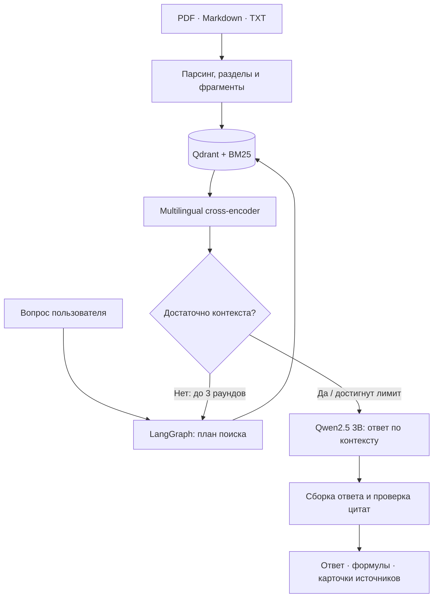

<div align="center">

# ResearchMind

### Agentic RAG · Local LLM · ML Research

Локальный ассистент для исследования ML-литературы на русском и английском.<br/>
Поиск по документам, объяснения с формулами и ответы с проверяемыми источниками.


[Возможности](#возможности) · [Архитектура](#архитектура) · [Модели](#модели) · [Запуск](#быстрый-старт) · [Проверки](#проверки-и-оценка)

</div>

---

> **Идея проекта:** локальный RAG-ассистент, который ищет подтверждения в ML-литературе и формирует ответы с цитатами. Используются готовые Qwen, embedding-модель и reranker; их веса в проекте не обучаются.

## Возможности

- **Три режима retrieval:** Naive, Hybrid и Agentic RAG для сравнения на одном корпусе.
- **Русский и английский:** мультиязычные embeddings и reranker, русскоязычные статьи и ML Handbook.
- **Hybrid Search:** семантический поиск в Qdrant + BM25 по ключевым словам.
- **Поиск с повторными попытками:** LangGraph планирует поиск, оценивает покрытие вопроса и при необходимости повторяет его — до трёх раундов.
- **Иерархия контекста:** поиск по небольшим фрагментам с расширением до родительского раздела. В Markdown сохраняются целые формулы и блоки кода.
- **Ответ под задачу:** объяснение, формула, сравнение или исследование; краткий, обычный и развёрнутый форматы.
- **Источники рядом с ответом:** уникальные карточки документов, релевантные выдержки, страницы PDF и ссылки на публикации.
- **Свои документы:** загрузка PDF, Markdown и TXT через интерфейс или API, замена устаревших версий, проверка дубликатов.
- **Локальная работа:** после скачивания моделей и подготовки корпуса обычный запрос не требует внешнего LLM API. Внешний поиск включается отдельно.

### Примеры запросов

> «Опиши алгоритм линейной регрессии: формула, функция ошибки и обучение».
>
> «Сравни Lasso и Ridge по штрафу и отбору признаков».
>
> «Сравни LoRA и QLoRA по требованиям к памяти. Приведи источники».

Это примеры задач, а не обещание безошибочного ответа. Для составных вопросов особенно важна проверка найденных источников.

## Архитектура



Схема показывает основной путь Agentic RAG. Повторный поиск также ограничивается отсутствием новых фрагментов. Для базовых учебных вопросов используется дополнительный поиск по заголовкам Handbook; при необходимости определение или формула приводятся дословно из подходящего раздела.

Основной режим `legacy` формирует объяснение с помощью локальной модели и проверяет цитаты. Дополнительно реализован экспериментальный `grounded`: модель выбирает ID исходных абзацев, программа собирает из них ответ с формулами и фильтрует учебные задания и графический шум PDF. Цитаты сохраняют язык оригинала. Этот режим не включён по умолчанию: на внутреннем тесте он снизил полноту ответа. Принадлежность цитаты источнику сама по себе не доказывает её релевантность вопросу.

Экспериментальные режимы `legacy` и `structured` поддерживают пересказ с самопроверкой Qwen. В проверочных прогонах такая проверка пропускала ошибки, поэтому она не считается гарантией правильности. **Даже точная цитата может оказаться неполной или не подходить вопросу.**

| Режим | Как ищет |
|---|---|
| Naive | Один dense-поиск, без BM25 и reranking |
| Hybrid | Dense + BM25, объединение через Reciprocal Rank Fusion и reranking |
| Agentic | Планирование поверх hybrid retrieval, оценка покрытия и ограниченные повторные попытки |

E5 получает разные префиксы для вопроса и документа — `query:` и `passage:`. Индексы и кэш векторов разделены по embedding-конфигурации и структуре фрагментов.

## Технологии

| Задача | Технология |
|---|---|
| Язык и зависимости | Python 3.11–3.13, uv, lock-файл |
| API и схемы | FastAPI, Pydantic, Uvicorn |
| Интерфейс | Streamlit |
| Оркестрация агента | LangGraph |
| Векторный индекс | Qdrant: локальное хранилище или сервер |
| Dense retrieval | Sentence Transformers, `intfloat/multilingual-e5-small` |
| Поиск по словам | BM25, нормализация и stemming |
| Reranking | `corrius/cross-encoder-mmarco-mMiniLMv2-L12-H384-v1` |
| Основная локальная LLM | Ollama, `qwen2.5:3b` |
| Документы | pypdf, Beautiful Soup, Markdown/TeX |
| Эксперименты | JSONL/CSV, опционально Ragas |
| Развёртывание и проверки | Docker Compose, PowerShell, pytest, Ruff |

Reranker используется из доступной копии модели mMARCO. Модули Ragas относятся к дополнительным зависимостям; для обычного запуска API они не обязательны.

## Библиотека документов

Состав проверенной локальной библиотеки:

| Материалы | Всего | На русском |
|---|---:|---:|
| Научные статьи PDF | 201 | 27 |
| Учебные материалы PDF | 24 | 23 |
| Главы Yandex ML Handbook | 73 | 73 |
| **Документы** | **298** | **123** |

В этой конфигурации получено **26 972 поисковых фрагмента**. Темы включают классический ML, ансамбли, регуляризацию, оптимизацию, NLP, компьютерное зрение, RL, графы, RAG, LoRA/QLoRA и квантование, включая TurboQuant.

Источники — arXiv, ACL Anthology, российские научные журналы, курс ML HSE и Yandex ML Handbook. Русские материалы являются оригинальными публикациями и учебными текстами.

Каталог находится в [examples/papers.json](examples/papers.json). Для документов сохраняются URL и SHA-256; проверяются canonical ID, хеш PDF и извлечённого текста. Недоступные и непригодные для парсинга материалы не объявляются подключёнными. Из 233 PDF-кандидатов в проверенную библиотеку вошли 225.

> PDF, модели и индексы исключены из Git. Числа выше описывают подготовленную локальную библиотеку, а не содержимое свежего клона. Фактический результат нового скачивания зависит от доступности источников.

### Скачать все источники себе

В [sources.txt](sources.txt) перечислены **все 298 документов** проверенной библиотеки: один документ на строку. Это UTF-8 файл с колонками через табуляцию: название, страница источника, прямая ссылка для скачивания, имя файла, тип и язык. Для глав Handbook ссылка ведёт на HTML-страницу, которую скрипт сохраняет как Markdown с формулами. PDF и тексты не включены в Git — скачиваются оригиналы с сайтов авторов и издателей.

Из корня клонированного проекта (Python 3.11–3.13 и [uv](https://docs.astral.sh/uv/getting-started/installation/)):

```powershell
uv sync --frozen
uv run python scripts/download_sources.py --dry-run
uv run python scripts/download_sources.py
```

Скрипт [scripts/download_sources.py](scripts/download_sources.py) загружает именно список из `sources.txt`: 225 PDF в `data/papers/` и 73 главы в `data/handbook/`. Модель, GPU, API и Docker для скачивания не нужны. Существующие файлы используются повторно; при обрыве можно запустить ту же команду. Для arXiv предусмотрены паузы, для PDF проверяются формат и дубли, для Handbook учитывается `robots.txt`. Ошибки сохраняются в `data/papers/import-status.json` и `data/handbook/manifest.json`; при незавершённой загрузке скрипт возвращает ненулевой код.

```powershell
# Только PDF / только главы учебника
uv run python scripts/download_sources.py --kind pdf
uv run python scripts/download_sources.py --kind handbook
# Другая папка для локальной копии
uv run python scripts/download_sources.py --data-dir D:/ML-library
```

В Linux/macOS работают те же команды `uv`. Если окружение уже установлено, можно использовать `.venv\Scripts\python.exe` в Windows или `.venv/bin/python` в Linux/macOS вместо `uv run python`.

Скачивание сохраняет документы, но не создаёт поисковый индекс. Для подключения стандартной папки `data/` запустите `start.ps1` по инструкции ниже — он подготовит модели и индекс. Для другой папки сначала задайте `RESEARCH_DATA_DIR` в `.env`. Доступность сайтов и версии материалов могут меняться; права на документы остаются у авторов и издателей.

## Модели

### Qwen: основная модель ответов

Для пользовательских ответов используется готовая instruction-модель **Qwen2.5:3b**, запускаемая локально через Ollama. В проверенной установке — квантование Q4_K_M, окно приложения 6144 токена и лимит генерации 2000 новых токенов. Длина ответа зависит от найденного материала и выбранной подробности. Увеличение лимита само по себе не повышает смысловую точность.

**Qwen не обучалась в этом проекте.** Её знания дополняются найденными документами во время запроса. Embedding-модель и reranker также используются готовыми, без собственного дообучения.

## Быстрый старт

Инструкция по первой публикации кода без моделей и локальных данных: [GITHUB.md](GITHUB.md).

### Windows: Python + Ollama

Понадобятся Python 3.11–3.13, [uv](https://docs.astral.sh/uv/) и [Ollama](https://ollama.com/download/windows).

Скачайте или клонируйте репозиторий, откройте PowerShell в его корне:

```powershell
.\start.ps1
```

Скрипт создаёт `.env` из [.env.example](.env.example), устанавливает зависимости по `uv.lock`, при необходимости запускает отдельную Ollama проекта на порту **11435**, скачивает модели и готовит индекс. Уже подготовленные артефакты используются повторно.

| Сервис | Адрес |
|---|---|
| Интерфейс | http://127.0.0.1:8501 |
| Swagger / API | http://127.0.0.1:8000/docs |
| Проверка готовности | http://127.0.0.1:8000/health |

Остановка API/UI:

```powershell
.\stop.ps1
```

Ollama остаётся запущенной. Для обновления библиотеки остановите API и выполните `.\start.ps1 -RefreshLibrary`.

### Docker Compose

Нужен запущенный Docker Desktop с Linux containers. Python и Ollama на хосте для Docker-варианта не обязательны.

Первый запуск из свежего клона, со сборкой образа:

```powershell
.\start-docker.ps1 -Build
```

Для NVIDIA GPU с поддержкой GPU/WSL2 в Docker Desktop:

```powershell
.\start-docker.ps1 -Gpu -Build
```

Если актуальный `researchmind:local` уже собран, повторный запуск — `.\start-docker.ps1` или `.\start-docker.ps1 -Gpu`.

Compose состоит из **трёх контейнеров**: приложение с подготовкой/API/UI, Qdrant и Ollama. Скрипт проверяет лимит **не больше трёх контейнеров всего**, включая существующие и остановленные. Служебные образы Qdrant/Ollama скачиваются отдельно от образа приложения.

```powershell
# Прогресс подготовки и запуск приложения
docker compose -p researchmind logs -f app

# Остановка с сохранением данных
docker compose -p researchmind down
```

Для GPU-варианта при остановке используйте оба compose-файла, как описано в [DOCKER.md](DOCKER.md). Перед переходом с нативного запуска остановите его API/UI и освободите GPU от нативной копии модели. Подробности портов, томов и пересборки также находятся в [DOCKER.md](DOCKER.md).

### Первый запуск и место на диске

Первое скачивание моделей, документов и построение индекса требуют интернета и могут занять значительное время. CPU поддерживается, но генерация медленнее.

Проверенная конфигурация — **16 ГБ RAM и RTX 3050 Laptop 4 ГБ**. В локальной установке файлы моделей занимали около 3,6 ГиБ, документы — около 0,7 ГиБ, Python-окружение — около 6 ГиБ; вся папка проекта — около 12 ГиБ. Docker дополнительно хранит образы, кэш сборок и виртуальный диск. Это измерения конкретной установки, а не минимальные системные требования.

## Использование

1. Откройте Streamlit и загрузите свои PDF, Markdown или TXT либо используйте подготовленный корпус.
2. Выберите `naive`, `hybrid` или `agentic`.
3. Укажите формат и подробность ответа.
4. Задайте вопрос и проверьте карточки источников под ответом.

Загрузка файла ограничена **25 МБ**. Сканированные PDF без текстового слоя требуют внешнего OCR.

Пример запроса через API:

```powershell
$body = @{
    question = 'Опиши алгоритм линейной регрессии'
    mode = 'agentic'
    answer_mode = 'explain'
    detail = 'standard'
    allow_web = $false
} | ConvertTo-Json

Invoke-RestMethod -Method Post `
    -Uri 'http://127.0.0.1:8000/query' `
    -ContentType 'application/json; charset=utf-8' `
    -Body ([System.Text.Encoding]::UTF8.GetBytes($body))
```

В ответе доступны `answer`, `articles`, `sources`, `verification`, `trace`, `usage` и `latency_ms`. Основные endpoints: `GET /health`, `GET /documents`, `POST /documents`, `POST /query`.

Настройки хранятся в `.env`. Для внешнего поиска требуется Tavily API key и явное разрешение в запросе; по умолчанию внешний поиск выключен.

## Проверки и оценка

```powershell
# Тесты: сеть, GPU и скачивание весов не нужны
.venv\Scripts\python.exe -m pytest tests -q

# Проверка восьми вопросов на запущенном API
.venv\Scripts\python.exe -m researchmind.smoke --output reports/product-smoke
```

В последней проверке основного набора прошли **76 тестов**: retrieval, разбиение документов, кэш, принадлежность цитат, фильтрация PDF-шума, fallback, отсутствие дублей, каталог источников и отображение формул. Это результат локального запуска, не статус GitHub CI.

### Подбор гиперпараметров

Для RAG сравнивались профили dense/BM25, размер пула reranker, разнообразие контекста, распознавание методов и форматы ответа. На 24 RU/EN вопросах разделены dev-выбор и итоговая проверка. Помимо параметров исправлялся отбор учебных разделов и фрагментов; результат не приписывается одному `top_k`.

Поиск focused повысил reference Hit@5 с 8/12 до 9/12 на тесте. Однако кандидат итогового ответа `grounded` снизил покрытие аспектов с 72,2% до 52,8%; он сохранён как эксперимент, а рабочие параметры оставлены прежними. Полнота и фактическая корректность ответов пока остаются ограничением проекта.

Параметры и сравнение: [docs/TUNING.md](docs/TUNING.md). Вопросы с рубриками: [examples/tuning_questions.json](examples/tuning_questions.json). Рубрики измеряют наличие аспектов, **не фактическую точность**. Для Docker после обновления кода нужна пересборка через `start-docker.ps1 -Build`; существующие контейнеры предварительно останавливаются, как описано в [DOCKER.md](DOCKER.md).

Для сравнения Naive/Hybrid/Agentic предусмотрен `researchmind.evaluate`:

| Метрика | Что оценивает |
|---|---|
| Recall@5 | Долю размеченных релевантных документов среди первых пяти фрагментов |
| MRR@5 | Позицию первого релевантного результата в top-5 |
| Faithfulness | Поддержку ответа контекстом через опциональный Ragas judge |
| Latency | Время обработки запроса |
| LLM token cost | Доступные сведения о стоимости токенов внешнего провайдера |

Evaluator принимает JSONL с полями `id`, `question`, `relevant_sources`. Для Ragas нужны дополнительные зависимости (`uv sync --extra models --extra dev --extra eval`) и отдельно настроенный совместимый judge endpoint. Стоимость локального GPU/электричества в метрику token cost не входит.

Для проверки текущей конфигурации используйте `researchmind.benchmark_ml` и набор `examples/classical_ml_50.json`. Старые результаты других версий не описывают текущую Qwen-конфигурацию. **Наличие цитаты и `verification.passed` не равны точности ответа или независимой faithfulness.**

Состав корпуса сохраняется в `data/papers/downloads.json` и `data/handbook/manifest.json`, ревизии моделей — в `data/model-revisions.json`, состояние индекса — в `data/index-status.json`. Сырые результаты находятся в `reports/`. Данные и большие артефакты не публикуются в Git.

## Структура проекта

```text
researchmind/
├── api.py              # FastAPI, документы и вопросы
├── engine.py           # LangGraph: plan → retrieve → assess → generate → verify
├── store.py            # Dense/BM25 retrieval, reranker, Qdrant и кэш
├── ingest.py           # Парсинг, разделы и дочерние фрагменты
├── composer.py         # Qwen, структурированный ответ и проверка пересказа
├── corpus.py           # Скачивание и проверка PDF-каталога
├── handbook.py         # Подготовка ML Handbook
└── evaluate.py         # Сравнение вариантов RAG

examples/               # Каталог публикаций и контрольные вопросы
scripts/                # Подготовка каталога и вспомогательные проверки
ui.py                   # Streamlit
start.ps1 / stop.ps1    # Нативный запуск
start-docker.ps1        # Docker с проверкой лимита контейнеров
compose*.yaml           # Три сервиса, опциональный GPU
```

## Ограничения

- Маленькая Qwen может давать неполные сравнения и неточные пересказы даже с валидной ссылкой.
- Основной режим ограничивает свободную генерацию исходными фрагментами, но может выбрать неподходящий абзац, дать неполный ответ или оставить иностранную цитату без перевода.
- Отвечающая и проверяющая модель одна и та же; такая проверка может ошибаться.
- Лексическое покрытие вопроса — эвристика управления поиском, а не доказательство полноты ответа.
- OCR не встроен; качество таблиц и формул из PDF зависит от текстового слоя. Формулы Markdown/TeX сохраняются надёжнее.
- Доступность публикаций и идентичность нового корпуса зависят от сайтов-источников.

## Источники и права

Проект использует [Yandex ML Handbook](https://education.yandex.ru/handbook/ml), [ML HSE](https://github.com/esokolov/ml-course-hse), научные публикации и готовые модели.

Условия авторов и издателей сохраняются. Локальный исследовательский кэш не означает разрешение на перепубликацию PDF, учебников, датасетов или весов. `data/`, `.env` и локальные отчёты исключены из Git.

